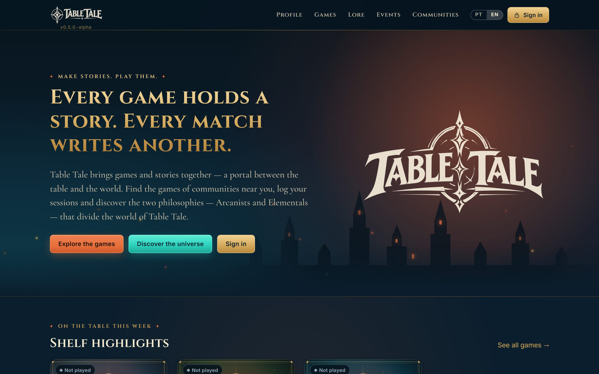
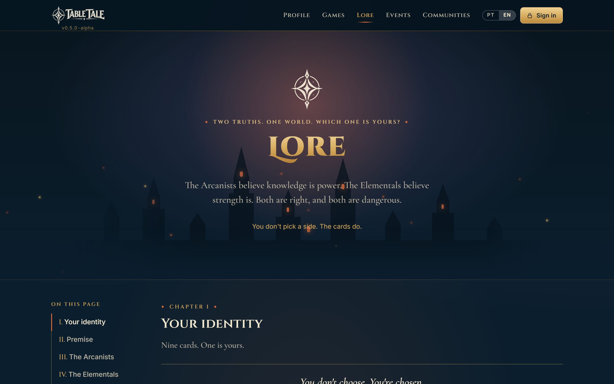
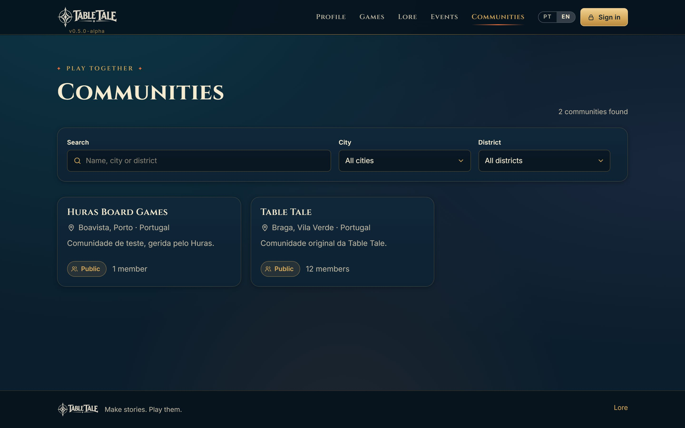

<div align="center">

# ✦ Table Tale ✦

**Make stories. Play them.**

A home for board game communities: find the games on the shelves near you, log your sessions,
and draw the Fate card that decides whether you stand with the **Arcanists** or the **Elementals**.

[](https://jgabrielmaia.com/table-tale/)
[](https://github.com/jgabrielmaia/table-tale/releases)
[](https://github.com/jgabrielmaia/table-tale/actions/workflows/ci.yml)



</div>

> **Alpha.** Table Tale is in alpha: features, data and URLs may change between versions.
> See the [release notes](docs/release-notes) and the [roadmap](https://github.com/users/jgabrielmaia/projects/6).

## What you can do

| | |
|---|---|
| 🎲 **Games near you** | Every game on the shelves of communities within 5–100 km, with distance, copies, BGG categories and mechanics. |
| 🏰 **Communities** | Create or join communities, each with its own location, members, roles, cover photo and game library. Private ones take membership requests. |
| 🃏 **Fate Draw** | Draw one of nine Fate cards to reveal your identity and your faction. You don't pick a side. The cards do. |
| ⚖️ **Faction balance** | Every community shows how many Arcanists and Elementals live there, as a neon bar. |
| ⏱️ **Sessions** | Time your games, rate them, mark favourites and track them as Not played, Playing or Played. |
| 🏆 **Profile and achievements** | Level, XP, stats and achievements such as *Keeper of the Shelf* for owning a community, plus a public player page. |
| 📜 **Lore** | The story of the two philosophies that divide the world of Table Tale. |
| 🌍 **Portuguese and English** | The whole interface in both languages, on phone and desktop. |

<table>
  <tr>
    <td></td>
    <td></td>
  </tr>
  <tr>
    <td align="center"><sub>Lore</sub></td>
    <td align="center"><sub>Communities</sub></td>
  </tr>
</table>

## Built with

- **Frontend:** React 19, TypeScript, Vite, Tailwind CSS 4, React Router, TanStack Query, React Hook Form and Zod
- **Backend:** Supabase (Postgres with row-level security, Auth, Storage and Edge Functions)
- **Integrations:** BoardGameGeek (behind a feature flag) and API Ninjas city search
- **Quality:** Vitest and Testing Library, Playwright end-to-end tests, and a CI job that migrates, rolls back and re-migrates a throwaway Postgres
- **Hosting:** Vercel, deployed by GitHub Actions only after CI passes on `main`

## Run it locally

Requires Node.js 22 or later.

```bash
npm ci
cp .env.example .env   # then fill in your Supabase URL and anon key
npm run dev            # http://localhost:5173/table-tale/
```

Without Supabase configured the pages show setup and error states. For real data, apply the migrations in `supabase/migrations` and run the seed, as described in [docs/auth-setup.md](docs/auth-setup.md).

| Command | What it does |
|---|---|
| `npm run dev` | Start the dev server |
| `npm test` | Unit tests (Vitest) |
| `npm run test:e2e` | End-to-end tests (Playwright) |
| `npm run typecheck` | Type checks |
| `npm run build` | Production build with prerendered pages in `dist/table-tale/` |
| `npm run seed` | Seed the catalogue (needs the service role key) |

### Feature flags

Flags are read at build time, so changing one needs a new build.

| Flag | Default | Turns on |
|---|---|---|
| `VITE_FEATURE_BGG` | `false` | BoardGameGeek search and import ([docs/bgg-integration.md](docs/bgg-integration.md)) |

## Project layout

```
src/
  features/      one folder per area: auth, communities, fate, games, lore, players, profile…
  components/    shared UI
  i18n/          Portuguese and English messages
supabase/
  migrations/    database changes, each with a rollback in rollbacks/
  functions/     Edge Functions: bgg, city-search
  ci/            SQL checks run by CI after migrating
tests/e2e/       Playwright specs against a fake backend
docs/            setup guides and release notes
```

## Docs

- [Authentication setup](docs/auth-setup.md)
- [Communities](docs/communities.md)
- [BoardGameGeek integration](docs/bgg-integration.md)
- [City search](docs/city-search.md)
- [Release notes](docs/release-notes)

<div align="center">
<sub>✦ Every game holds a story. Every match writes another. ✦</sub>
</div>
